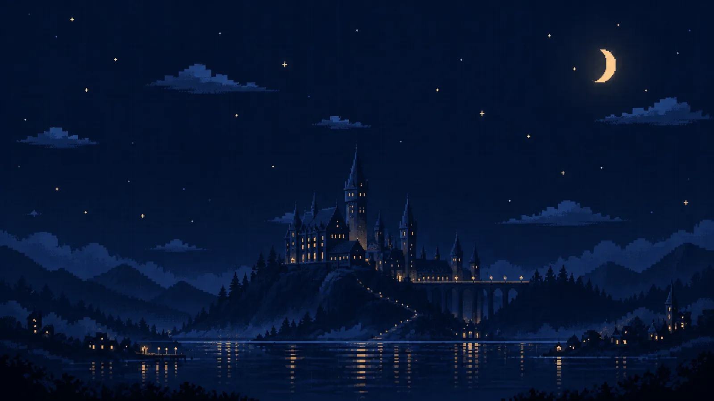
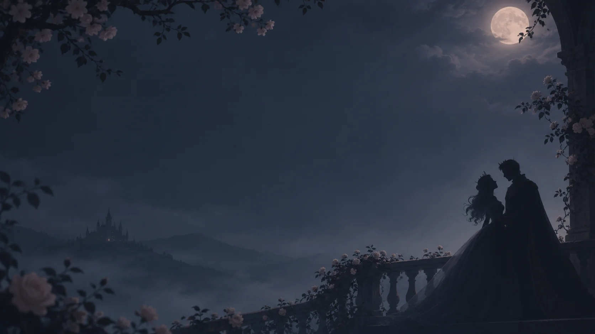
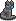

# ☾ ChatGPT Dreamscape

**Biến ChatGPT thành không gian của riêng bạn. · Make your ChatGPT feel like home.**

**Ngôn ngữ / Languages:** [🇻🇳 Tiếng Việt](#tieng-viet) · [🇬🇧 English](#english)

---

## 🇻🇳 Tiếng Việt

**ChatGPT Dreamscape** là một userscript mã nguồn mở giúp bạn tùy chỉnh giao diện ChatGPT trên **trình duyệt máy tính** bằng những hình nền giàu cảm xúc và một người bạn pixel nhỏ tên **Victor**.

> **Bản xem trước v0.3.1.** Đây là dự án cộng đồng độc lập, không phải tính năng chính thức của OpenAI. Giao diện ChatGPT có thể thay đổi và ảnh hưởng đến userscript; nếu phát hiện lỗi, hãy [tạo issue](https://github.com/ahtuan171/Chatgpt-Dreamscape/issues).

### 🎬 Video demo

[Xem video giới thiệu ChatGPT Dreamscape](demo-1.mp4).

### 🖼️ Thư viện hình nền

Ba hình nền gốc đang được tích hợp sẵn. Bạn cũng có thể thêm hình nền của riêng mình.

| Moonlit Castle | Midnight Tulips | Prince & Princess |
| :---: | :---: | :---: |
|  |  |  |

Các hình nền được thiết kế theo tông tối để giữ nội dung hội thoại dễ đọc. Bộ sưu tập sẽ được chọn lọc và mở rộng dần.

### ✨ Tính năng

- **Đổi hình nền:** lựa chọn một trong ba hình nền có sẵn hoặc tải ảnh cá nhân (PNG, JPG, WebP).
- **Tùy chỉnh từng ảnh:** xem trước, điều chỉnh độ tối và vị trí hiển thị theo chiều ngang (0% trái · 50% giữa · 100% phải khi ảnh bị cắt).
- **Lưu trữ trên thiết bị:** ảnh cá nhân được xử lý và lưu trong trình duyệt bằng IndexedDB; không tải lên máy chủ hình nền.
- **Victor — bạn mèo pixel:** xuất hiện gần góc phải phía trên ô nhập, đi lại một đoạn ngắn, quay đầu, chớp mắt và ngủ; có thể bật/tắt và tôn trọng tùy chọn giảm chuyển động.
- **Giao diện dễ đọc:** giữ thanh bên và ô nhập hoạt động bình thường; có thể tắt hiệu ứng tùy chỉnh để trở lại giao diện mặc định.
- **Tôn trọng quyền riêng tư:** không có công cụ phân tích hành vi, không thu thập nội dung hội thoại.

### 🚀 Cài đặt (không cần terminal)

1. Cài trình quản lý userscript trên trình duyệt máy tính, chẳng hạn [Tampermonkey](https://www.tampermonkey.net/) hoặc [Violentmonkey](https://violentmonkey.github.io/).
2. Nhấn **[Cài đặt ChatGPT Dreamscape](https://github.com/ahtuan171/Chatgpt-Dreamscape/raw/refs/heads/main/dist/dreamscape.user.js)**, sau đó chọn **Install / Cài đặt** khi trình quản lý userscript mở ra.
3. Truy cập hoặc tải lại [ChatGPT](https://chatgpt.com/). Nhấn biểu tượng **☾** ở góc dưới bên phải để chọn hình nền, thêm ảnh và bật/tắt Victor.

Nếu trình duyệt tải tệp `.user.js` xuống thay vì mở trang cài đặt, hãy nhập tệp vào trình quản lý userscript. Một số trình duyệt dựa trên Chromium có thể yêu cầu bật quyền **Allow User Scripts** trong cài đặt tiện ích.

**Nền tảng mục tiêu:** Chrome, Firefox, Edge và Brave trên Windows, macOS và Linux (ưu tiên kiểm thử Chrome và Firefox). Chưa hỗ trợ chính thức trình duyệt di động hoặc ứng dụng ChatGPT desktop. Khả năng tương thích trên mọi trình duyệt vẫn cần kiểm chứng thực tế.

### 🔧 Khắc phục lỗi: Không thấy Dreamscape

Nếu hình nền, Victor hoặc nút **☾** không xuất hiện, Tampermonkey có thể chưa được phép chạy userscript. Với **Chrome 138 trở lên** và một số trình duyệt Chromium:

1. Mở `chrome://extensions/` → **Tampermonkey** → **Details** → bật **Allow User Scripts** (có thể cần bật **Developer mode** trước; tên tùy chọn có thể khác tùy trình duyệt).
2. Vào **Tampermonkey Dashboard**, kiểm tra **ChatGPT Dreamscape** đã được bật.
3. Tải lại [chatgpt.com](https://chatgpt.com/).

**Kiểm tra nhanh (không bắt buộc):** Nhấn `F12` → **Console** rồi chạy `!!document.querySelector("#dreamscape-app")`. Kết quả `true` nghĩa là giao diện Dreamscape đã được chèn vào trang; nếu hình nền vẫn không hiện, hãy kiểm tra nút bật giao diện trong phần cài đặt **☾**.

### 🐈 Gặp Victor

**Victor** là thú cưng mặc định và duy nhất đi kèm bản công khai. Bạn có thể tắt Victor nếu thích một giao diện yên tĩnh. Các sprite Spidey cá nhân không nằm trong dự án.

**Nếu từng cài phiên bản Dreamscape cũ**, hãy tắt các userscript Dreamscape trước đó trong Tampermonkey để tránh hiển thị trùng lặp.

### 🎨 Thêm hình nền cá nhân

Mở **☾ → Add wallpaper**, chọn ảnh PNG/JPEG/WebP dung lượng dưới **15 MB**. Dreamscape có thể thu nhỏ ảnh lớn (tối đa 2400 × 1600), chuyển sang WebP và lưu bằng IndexedDB trong trình duyệt.

Bạn có thể đổi ảnh, làm tối, chỉnh vị trí hoặc xóa hình nền đã nhập. Các hình nền này không tự đồng bộ giữa những trình duyệt, hồ sơ người dùng hay máy tính khác nhau; việc xóa dữ liệu trang web có thể làm mất ảnh đã lưu.

Nếu bạn đang dùng hình nền mặc định đã bị loại bỏ ở phiên bản mới, Dreamscape sẽ chuyển về **Moonlit Castle**; hình nền cá nhân vẫn được giữ lại.

### 🛠️ Dành cho người đóng góp

Người dùng thông thường **không cần tải mã nguồn hoặc sử dụng terminal**. Nếu muốn phát triển hoặc đóng góp:

~~~bash
git clone https://github.com/ahtuan171/Chatgpt-Dreamscape.git
cd Chatgpt-Dreamscape
node tools/build.mjs
python -m pip install playwright
python -m playwright install chromium
python tests/test_browser.py
~~~

Mã nguồn ở [`src/`](src/), ảnh ở [`assets/`](assets/), bộ công cụ build ở [`tools/`](tools/) và userscript cài đặt ở [`dist/dreamscape.user.js`](dist/dreamscape.user.js). Bài kiểm thử dùng giao diện ChatGPT mô phỏng, **không phải** tài khoản ChatGPT thật; xem [hướng dẫn kiểm thử](docs/TESTING.md).

### 🛡️ Lưu ý & giấy phép

- Dreamscape chỉ chạy trên `https://chatgpt.com/*`; hãy kiểm tra quyền userscript trước khi cài.
- Script chỉ nhận biết hoạt động gõ trong ô nhập để kích hoạt Victor, không lưu nội dung tin nhắn.
- Nếu cập nhật giao diện ChatGPT làm Dreamscape hoạt động sai, bạn có thể tắt script và [báo lỗi](https://github.com/ahtuan171/Chatgpt-Dreamscape/issues).
- **Mã nguồn** sử dụng [giấy phép MIT](LICENSE). **Hình nền và sprite Victor** có điều khoản riêng tại [ASSETS.md](ASSETS.md). Không đưa hình ảnh bên thứ ba vào bản phân phối khi chưa có quyền phù hợp.

---

## 🇬🇧 English

**ChatGPT Dreamscape** is an independent, open-source userscript that brings atmospheric wallpapers and **Victor**, a tiny gray pixel cat, to the **desktop ChatGPT web interface**.

> **Early public preview · v0.3.1.** This is a community customization, not an official OpenAI feature. Changes to ChatGPT's interface may affect compatibility. Please [open an issue](https://github.com/ahtuan171/Chatgpt-Dreamscape/issues) when something breaks.

### 🎬 Demo video

[Watch the ChatGPT Dreamscape demo](demo-1.mp4).

### 🖼️ Built-in wallpapers

The three bundled originals are **Moonlit Castle**, **Midnight Tulips**, and **Prince & Princess**. See the [wallpaper gallery above](#tieng-viet); you can also import your own images.

### ✨ Features

- **Custom wallpapers:** choose a built-in image or import a PNG, JPEG or WebP file.
- **Per-wallpaper controls:** preview images, adjust darkness, and change horizontal cropping (0% left · 50% center · 100% right when cropped).
- **Local storage:** your personal images are processed and saved in your browser with IndexedDB, not uploaded to a wallpaper server.
- **Victor:** an optional gray pixel cat near the composer's upper-right corner. He walks a short distance, turns to face the return direction, blinks and sleeps; reduced-motion preferences are respected.
- **Readable interface:** the sidebar and composer remain functional, and custom styling can be turned off.
- **Privacy-first:** no analytics and no collection of conversation text.

### 🚀 Install (desktop only; no terminal)

1. Install a userscript manager, such as [Tampermonkey](https://www.tampermonkey.net/) or [Violentmonkey](https://violentmonkey.github.io/), in your desktop browser.
2. Click **[Install ChatGPT Dreamscape](https://github.com/ahtuan171/Chatgpt-Dreamscape/raw/refs/heads/main/dist/dreamscape.user.js)** and confirm **Install** in the userscript manager.
3. Open or refresh [ChatGPT](https://chatgpt.com/). Click **☾** at the bottom-right to switch wallpapers, upload an image, or toggle Victor.

If the browser downloads the `.user.js` instead of showing an installer, import that file through your userscript manager. Some Chromium-based browsers require enabling **Allow User Scripts** in extension settings.

**Compatibility targets:** Chrome, Firefox, Edge and Brave on Windows, macOS and Linux, with Chrome and Firefox receiving priority testing. Mobile browsers and desktop-app integration are out of scope. Broad desktop compatibility is a goal, not a guarantee for every release.

### 🔧 Troubleshooting: Dreamscape not showing

If the wallpaper, Victor or the **☾** button is missing, your browser may be blocking Tampermonkey userscripts. On **Chrome 138+** and some Chromium-based browsers:

1. Open `chrome://extensions/` → **Tampermonkey** → **Details** → enable **Allow User Scripts** (you may need **Developer mode** first; labels vary by browser).
2. Check that **ChatGPT Dreamscape** is enabled in the **Tampermonkey Dashboard**.
3. Reload [chatgpt.com](https://chatgpt.com/).

**Optional check:** Press `F12` → **Console** and run `!!document.querySelector("#dreamscape-app")`. `true` means the Dreamscape interface was inserted; if the wallpaper is still missing, check whether the theme is enabled in **☾** settings.

### 🐈 Meet Victor

Victor is the **only bundled pet**. He stays near the right corner of the composer, makes small walks, turns around and rests. You can disable him at any time. The personal red Spidey sprite is **not included** in the public release.

If you have an older Dreamscape installation, disable previous Dreamscape scripts before enabling the current one to prevent duplicate pets or conflicting styles.

### 🎨 Bring your own wallpaper

Choose **☾ → Add wallpaper**. Images must be PNG/JPEG/WebP and under **15 MB**. Dreamscape resizes large images (up to 2400 × 1600), converts them to optimized WebP locally, and saves them through IndexedDB.

You can select, dim, reposition or delete imported wallpapers. Images and settings belong to your browser profile and website origin; they do **not** automatically sync to other devices, and clearing browser data may remove them.

If a retired built-in wallpaper was selected, the updated script falls back to **Moonlit Castle** without deleting imported images.

### 🛠️ For contributors

Ordinary users **do not need a terminal, Node.js or a source checkout**. To work on the project:

~~~bash
git clone https://github.com/ahtuan171/Chatgpt-Dreamscape.git
cd Chatgpt-Dreamscape
node tools/build.mjs
python -m pip install playwright
python -m playwright install chromium
python tests/test_browser.py
~~~

Source files live in [`src/`](src/), assets in [`assets/`](assets/), build tooling in [`tools/`](tools/), and the installable userscript in [`dist/dreamscape.user.js`](dist/dreamscape.user.js). Bundled images are embedded into the build, so installed users do not need external wallpaper requests.

Browser tests use a **simulated ChatGPT page**, not a real signed-in ChatGPT session. See [Testing](docs/TESTING.md).

### 🛡️ Safety, limitations & licensing

- Dreamscape is restricted to `https://chatgpt.com/*`. Review userscript permissions before installing.
- It detects typing activity only to animate Victor; it does not store or transmit message content.
- ChatGPT UI changes may temporarily break appearance or pet positioning. Disable the script if needed and [report a bug](https://github.com/ahtuan171/Chatgpt-Dreamscape/issues).
- **Code:** [MIT License](LICENSE). **Bundled artwork and Victor sprites:** separate terms in [ASSETS.md](ASSETS.md). Do not redistribute unlicensed third-party imagery.
